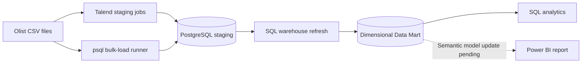

# Olist Customer Satisfaction Analytics

A Data Engineering and Business Intelligence project that integrates Olist transaction and review data into a PostgreSQL Data Mart, with Talend ingestion, SQL analytics, and a three-page Power BI report.

The engineering work covers typed CSV ingestion, staging deduplication, dimensional modeling, customer versioning, and explicit rules for measuring satisfaction across orders with multiple items. The current SQL model separates **review events**, **order delivery**, and **order items**, with a weighted bridge for product and seller attribution.

[SQL implementation](sql/load_data.sql) · [Analytical queries](sql/queries.sql) · [Dashboard previews](#power-bi-dashboard) · [Reproduction guide](#reproducing-the-project)

## Business context

The project uses the [Brazilian E-Commerce Public Dataset by Olist](https://www.kaggle.com/datasets/olistbr/brazilian-ecommerce), which contains anonymized marketplace orders from 2016–2018.

| Business question | Analytical approach |
|---|---|
| How does customer satisfaction change over time? | Review volumes, score distribution, and average ratings by purchase month |
| How do delivery outcomes relate to ratings? | Compare reviews across early, on-date, late, and unknown delivery outcomes |
| Which products and sellers warrant investigation? | Compare allocated review volumes and weighted ratings, with minimum-volume filters |
| Where does customer experience differ? | Compare ratings and review volumes by customer state |
| Where should operational teams investigate first? | Read satisfaction alongside volume and delivery performance to prioritize follow-up |

## Solution architecture



Talend handles file ingestion and invokes PostgreSQL transformations. SQL owns the warehouse logic; the PowerShell bulk-load runner provides an alternative ingestion route for reproducing and checking the same model.

**Artifact alignment:** the SQL scripts and separate DAX definitions describe the revised model. The saved PBIX, schema image, and dashboard screenshots still represent the original `f_avis` model. The [Power BI setup checklist](powerbi/POWER_BI_SETUP.md) records the remaining integration work.

## Data engineering and ETL

The [Talend project archive](etl/talend_project/PROJET_BI_SATISFACTION.zip) contains seven dedicated CSV ingestion jobs. Each follows `tPostgresqlRow → tFileInputDelimited → tMap → tPostgresqlOutput`: truncate its staging table, read a UTF-8 CSV with a header, map typed columns, and insert into PostgreSQL. Dates use `yyyy-MM-dd HH:mm:ss`; item prices and freight use decimal types. The mappings primarily pass source fields through; business transformations run in SQL.

The [`refresh_warehouse` procedure](sql/load_data.sql) performs the following work:

1. **Resolve repeated source rows.** Window functions select one row per order, customer source ID, product, seller, and order item. Reviews are deduplicated by `(review_id, order_id)`, favoring the latest answer and creation timestamps.
2. **Prepare dimensions.** Normalize customer and seller city/state text, enrich product categories through the translation table, and generate a continuous calendar spanning source dates. Missing translations fall back to the Portuguese category, then `unknown`.
3. **Derive analytical fields.** Calculate review timing, comment length and presence, positive/negative flags, and signed delivery variance. Load the separate facts and allocate each linked review across its order items.
4. **Record the refresh.** Update `etl_batch_audit` with the batch identifier, effective date, completion status, and selected row counts.

The warehouse refresh is transactional and rebuilds facts and non-customer dimensions. `d_client` is retained for version tracking. This is a full-refresh pipeline with a stateful customer dimension; `batch_id` labels the run rather than selecting an incremental source partition.

Validation code includes primary/foreign keys, unique business keys, score and flag checks, fixture-based reload and SCD2 tests, and full-dataset count and bridge-allocation assertions. The full-dataset runner also checks CSV headers. Its KPI values are printed for inspection; the current full-dataset assertions do not compare those values against fixed KPI targets.

## Dimensional data modeling

The [schema](sql/create_tables.sql) separates the following grains:

| Object | Grain and purpose |
|---|---|
| `f_review` | One valid `(review_id, order_id)` event; global satisfaction and review volumes |
| `f_order_delivery` | One loaded order; delivery eligibility and lateness, including orders without reviews |
| `f_order_item` | One `(order_id, order_item_id)`; product, seller, price, and freight analysis |
| `bridge_review_order_item` | One review-to-item pair; equal allocation of a review across its matched items |
| `f_avis` | Compatibility view joining reviews to items and delivery; its rows are review-item associations |

`d_temps`, `d_client`, and `d_commande` provide date, customer, and order keys to the facts. `d_produit` and `d_vendeur` relate to `f_order_item`; the review and item facts connect to the bridge through their surrogate keys. The review fact has separate purchase-date and review-creation-date keys. The existing [star-schema image](captures/powerbi/Shema_etoile.png) documents the original single-fact Power BI model.

### KPI interpretation

- **Review count and mean rating:** count and average rows in `f_review`. `review_id` alone is not the event key. Positive means a score of 4–5; negative means 1–2; a score of 3 belongs to neither group.
- **Delivery rate:** late orders divided by orders with both actual and estimated delivery dates. A positive calendar-day difference means late; a negative difference means early. The signed mean difference is distinct from the mean delay among late orders.
- **Product/seller attribution:** an order with several matched items allocates `1 / item_count` of each review to each item. Allocated volumes can be fractional. This attributes an order review to its items; it is not a product-specific review collected from the customer.
- **Coverage and time:** reviews without matched items remain in global KPIs but cannot enter product/seller analysis. The full-dataset assertions expect 759 such events. Monthly SQL analysis groups by purchase date.

### Customer history: SCD Type 2

`load_d_client(effective_date)` uses `customer_unique_id` as its business key and hashes normalized city/state attributes. It selects the latest customer snapshot by order date, closes a changed current version, and inserts a successor with a new surrogate key. A correction on the version's opening date updates that version in place. A partial unique index enforces at most one current version per customer.

The procedure is invoked during warehouse refresh and exercised by [SCD2 fixture tests](sql/tests/test_scd2.sql). It records changes between supplied snapshots; the static Olist files do not supply a complete location-change history. Rebuilt facts link to the **current customer version**, so geographic analysis reflects the latest selected location, not necessarily the location at purchase time.

The separate [demonstration script](sql/scd2_demo.sql) intends to simulate a change and roll it back, but its subquery inside `CALL` requires correction before execution. The Talend `J04_SCD2_Demo` job currently calls the loader with today's date; it does not simulate a change itself.

## SQL analytics

[`sql/queries.sql`](sql/queries.sql) covers global satisfaction, score distribution, monthly trends, customer geography, delivery performance, comment presence, and customer history. Product categories require at least 20 allocated reviews; the seller query selects ten low-rated sellers with at least 10 allocated reviews.

For example, category analysis preserves the allocation rule instead of averaging repeated review-item rows:

```sql
SELECT p.product_category_name_english AS category,
       ROUND(SUM(r.review_score * b.allocation_weight)
             / NULLIF(SUM(b.allocation_weight), 0), 2) AS weighted_rating,
       ROUND(SUM(b.allocation_weight), 2) AS allocated_reviews
FROM f_review r
JOIN bridge_review_order_item b ON b.review_key = r.review_key
JOIN f_order_item i ON i.order_item_key = b.order_item_key
JOIN d_produit p ON p.produit_key = i.produit_key
GROUP BY p.product_category_name_english
HAVING SUM(b.allocation_weight) >= 20
ORDER BY weighted_rating;
```

The original OLAP work also includes [year–quarter–month drill-down](captures/olap/05_olap_drilldown_temps.png) and [category `ROLLUP`](captures/olap/07_olap_rollup_categorie.png). These captures use the earlier `f_avis` model; the current query file contains monthly aggregation and weighted category analysis rather than those original queries.

## Power BI dashboard

The [Power BI report](powerbi/dashboard.pbix) presents three analytical views. The previews below show the original report and its saved filter context. Their values are historical outputs, not validation results for the revised warehouse.

### Global satisfaction

Review volume, rating distribution, satisfaction over time, and delivery-status comparisons support an initial review of customer experience. The saved preview selects `agro_industry_and_commerce`; the time axis is yearly despite the chart's monthly title.


### Product and seller analysis

Category ratings and volumes sit alongside seller identifiers and locations, supporting investigation of low ratings in context. This preview is filtered to customer state `AC`.


### Geographic analysis

State-level ratings and volumes are paired with a state-by-delivery-status matrix. The original views show lower ratings for late deliveries than early deliveries, motivating closer operational investigation. The preview retains a copied product/seller page heading.


The saved visual queries reference `public f_avis`. The separate [revised DAX measures](powerbi/measures_corrected.dax) use `f_review`, `f_order_delivery`, and the allocation bridge. Completing the transition requires matching imported table names, configuring relationships, replacing visual fields, and validating filter interactions, including delivery-status and category filtering. Refresh and reopen the PBIX before capturing replacement screenshots.

## Technology stack

| Technology | Role |
|---|---|
| PostgreSQL and PL/pgSQL | Staging, dimensional tables, transactional refresh, SCD2, and constraints |
| Talend Open Studio 7.3.1 | Typed CSV ingestion and invocation of PostgreSQL jobs |
| SQL | Window functions, joins, conditional aggregation, analytical queries, and assertions |
| Power BI Desktop and DAX | Semantic model, measures, slicers, charts, and analytical matrices |
| PowerShell and `psql` | Dataset loading, header checks, and validation runners |
| Docker | Optional isolated PostgreSQL validation runners using `postgres:17` |

## Repository structure

```text
BI-Customer-Satisfaction-Olist/
├── README.md
├── Dataset/                       # Source notes; local CSV files are Git-ignored
├── sql/
│   ├── create_tables.sql          # Staging, dimensions, facts, constraints, view
│   ├── load_data.sql              # Procedures and warehouse refresh invocation
│   ├── queries.sql                # Analytical queries
│   ├── scd2_demo.sql              # Standalone demo requiring a CALL correction
│   ├── tests/                     # Fixtures, constraint and SCD2 checks, runners
│   └── full_dataset/              # CSV loaders and dataset assertions
├── etl/talend_project/
│   ├── PROJET_BI_SATISFACTION.zip # Importable Talend project source
│   ├── context.example.properties
│   └── test_archive.ps1
├── powerbi/
│   ├── dashboard.pbix
│   ├── measures_corrected.dax
│   └── POWER_BI_SETUP.md
├── captures/                      # Power BI, Talend, PostgreSQL, and OLAP images
└── rapport_final.pdf              # Original project report, in French
```

The [project report](rapport_final.pdf) describes the original implementation and its design rationale. Use the current SQL files for the revised schema and loading behavior.

## Reproducing the project

### 1. Obtain the source data

Download the Olist dataset from the source linked above and extract these seven files into `Dataset/`. Raw CSV files are not tracked in Git.

```text
olist_customers_dataset.csv
olist_orders_dataset.csv
olist_order_items_dataset.csv
olist_order_reviews_dataset.csv
olist_products_dataset.csv
olist_sellers_dataset.csv
product_category_name_translation.csv
```

### 2. Prepare a dedicated PostgreSQL database

Create an empty database, for example `projet_bi_talend`, and configure local authentication. Run commands from the repository root. The Windows runners default to PostgreSQL 18's installation path; adjust `-Psql` for another installation.

Use a dedicated database: loaders truncate staging and rebuild warehouse objects, and the schema script replaces an existing `f_avis` object. `CREATE TABLE IF NOT EXISTS` does not migrate older table definitions.

### 3. Load through SQL or Talend

**SQL reproduction route:** the runner creates the schema, validates headers, loads each CSV with client-side `\copy`, executes `load_data.sql`, and runs the full-dataset assertions.

```powershell
powershell -NoProfile -File .\sql\full_dataset\run_full_dataset_local.ps1 -Database projet_bi_talend -User postgres -DbHost localhost -Port 5432
```

**Talend route:** initialize the schema and procedures in the empty database first. `load_data.sql` defines the procedures and immediately invokes a refresh, which will be empty at this stage.

```powershell
$psql = 'C:\Program Files\PostgreSQL\18\bin\psql.exe'
& $psql -X -v ON_ERROR_STOP=1 -U postgres -d projet_bi_talend -f .\sql\create_tables.sql
& $psql -X -v ON_ERROR_STOP=1 -U postgres -d projet_bi_talend -f .\sql\load_data.sql
```

Import the ZIP into a compatible Talend Open Studio 7.3.1 installation. Configure its Default context using [context.example.properties](etl/talend_project/context.example.properties): set an absolute `data_dir`, connection details, `db_schema=public`, and a local password.

Run the seven dedicated `J01_Load_Staging_*` jobs for Customers, Orders, Reviews, Order_Items, Products, Sellers, and Category_Translation, then `J02_Load_Dimensions`. Despite its name, J02 invokes the complete warehouse refresh. `J03_Load_F_AVIS` now issues a review-count query. The additional `J01_Load_Staging_Rest` job uses legacy server-side `COPY` statements incompatible with the current staging columns; use the dedicated jobs.

### 4. Validate and explore

```powershell
powershell -NoProfile -File .\etl\talend_project\test_archive.ps1
powershell -NoProfile -File .\sql\tests\run_tests.ps1 -Database projet_bi_talend -User postgres
```

The SQL test runner creates and drops the reserved `bi_foundation_test` schema. Run it in the dedicated project database. It tests duplicate staging input, review-event uniqueness, allocation sums, fixture KPIs, constraints, repeated loads, and SCD2 changes. Docker alternatives are provided in [sql/tests](sql/tests) and [sql/full_dataset](sql/full_dataset); their temporary containers are removed after validation.

Run the queries in `sql/queries.sql` against the populated mart. The full-dataset assertions specify expected counts, including 99,224 review events, 99,441 orders, and 112,650 order items. These are checked-in baselines; they were not recalculated during this documentation review. The Talend archive check passed during review; Talend execution and Power BI refresh remain separate desktop checks.

### 5. Open and align Power BI

Open `powerbi/dashboard.pbix`, point it to the project database, and follow [POWER_BI_SETUP.md](powerbi/POWER_BI_SETUP.md) together with the model-alignment notes above. Apply the revised DAX, clear saved filters, verify the results against SQL, then save, close, and reopen the report. The existing PBIX requires this update before it can demonstrate the revised model.

## Key engineering highlights

- Separate fact grains preserve the distinction between review events, order delivery, and item attribution.
- A weighted bridge makes product and seller review volumes additive across matched items.
- PostgreSQL owns reusable transformation logic shared by Talend and the bulk-load route.
- Customer versioning combines a stable business key, attribute-change detection, validity dates, and current-row uniqueness.
- Fixture tests and dataset assertions make duplicate handling, referential integrity, and allocation rules inspectable.
