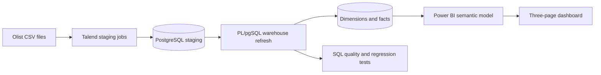
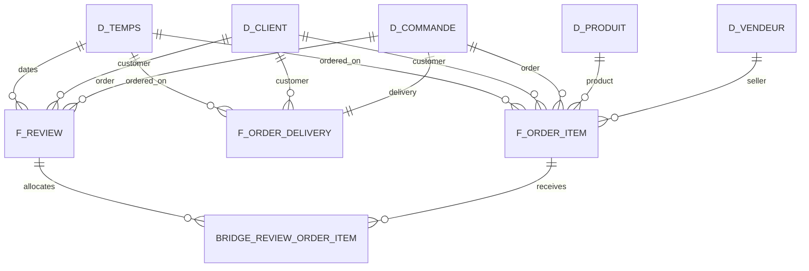
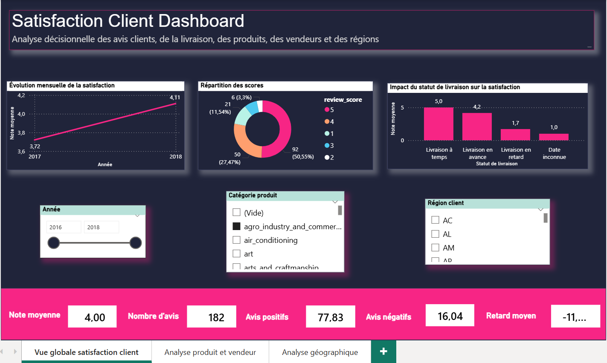
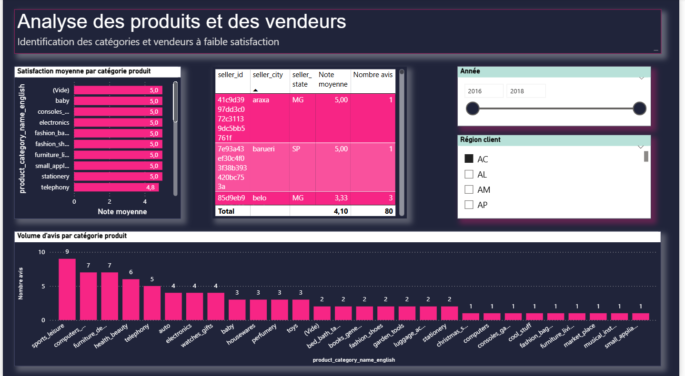
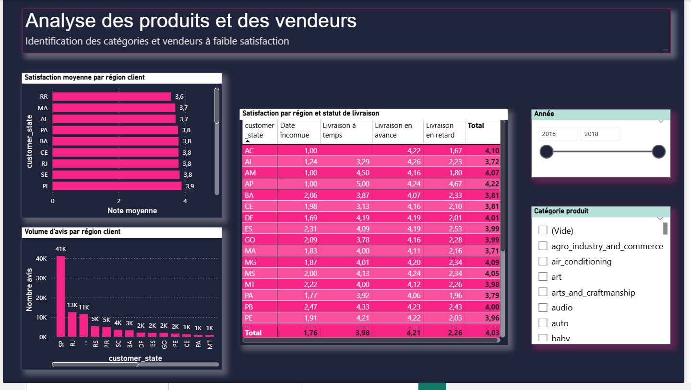

# Olist Customer Satisfaction — Data Engineering & BI

An end-to-end analytics project that turns the Brazilian Olist e-commerce
dataset into a quality-controlled dimensional warehouse and a three-page
customer-satisfaction dashboard.

## Validation status

| Area | Status |
|---|---|
| PostgreSQL schema, constraints, idempotency, and SCD2 tests | Passed on PostgreSQL 18.4 |
| Full Olist regression load | Passed twice consecutively on 2026-11-04 |
| Talend project structure and portability checks | Passed |
| Talend Studio execution | Not rerun: Talend Studio was unavailable in the validation environment |
| Power BI Desktop execution | Desktop engine opened; corrected model integration still requires the documented manual update |

Power BI and Talend are intentionally not presented as runtime-validated until
their remaining desktop checks have actually been completed.

## Technology stack

- PostgreSQL 18 and SQL/PL/pgSQL
- Talend Open Studio 7.3.1 project artifacts
- Power BI Desktop and DAX
- PowerShell validation runners

No dbt, Airflow, Spark, or additional orchestration layer is used.

## Architecture



The Talend jobs load the source files into staging tables. The
`refresh_warehouse` procedure applies deduplication, dimensions, SCD2 customer
history, order-level delivery facts, review-event facts, order-item facts, and
the weighted review-to-item bridge in one transaction.

## Dimensional model



The corrected model separates three grains:

- `f_review`: one row per valid `(review_id, order_id)` event.
- `f_order_delivery`: one row per order, used for delivery KPIs.
- `f_order_item`: one row per order item, used for product and seller analysis.

`bridge_review_order_item` allocates one review across its order items so item
analysis cannot inflate review counts. `d_client` implements SCD Type 2.

## Verified results

The full-dataset runner loads all seven source files into a clean staging layer,
refreshes the warehouse, and executes regression assertions.

| KPI | Verified value |
|---|---:|
| Review events | 99,224 |
| Average review score | 4.0864 |
| Positive review rate | 77.0680% |
| Late-delivery rate | 6.7737% |
| Order items | 112,650 |
| Review-item bridge rows | 112,372 |

The second consecutive load produced the same results, exactly one batch-audit
row, zero duplicate review events, and zero invalid current SCD2 memberships.

## Data quality controls

- Natural-key deduplication in staging consumption.
- Primary, unique, foreign-key, range, and flag-consistency constraints.
- Transactional warehouse refresh and batch audit.
- SCD2 current-row cardinality, date-range, change, and idempotency tests.
- Review-event grain, bridge coverage, and allocation-weight assertions.
- Full-dataset regression baselines for row counts and business KPIs.
- Talend archive checks for jobs, portability, generated files, and credentials.

## Dashboard

The report preserves three pages: global satisfaction, product and seller
analysis, and geographic analysis.







These images show the current layout. The PBIX still needs the corrected
semantic-model update and fresh screenshots before Power BI can be marked
validated. Follow [the exact Power BI checklist](powerbi/POWER_BI_SETUP.md);
it includes the relationships, measures, stale saved filters, format strings,
expected KPI values, and close/reopen validation.

## Reproduce the project

### 1. Prepare PostgreSQL

Create an empty database and run:

```powershell
psql -X -v ON_ERROR_STOP=1 -U postgres -d projet_bi_talend -f .\\sql\\create_tables.sql
```

Place the seven original Olist CSV files in `Dataset/`. The dataset is not
redistributed by this repository.

### 2. Run the SQL test suite

```powershell
powershell -NoProfile -ExecutionPolicy Bypass -File .\\sql\\tests\\run_tests.ps1 -Database postgres -User postgres
```

Docker users can instead run:

```powershell
powershell -NoProfile -ExecutionPolicy Bypass -File .\\sql\\tests\\run_tests_docker.ps1
```

### 3. Load and validate the full dataset

```powershell
powershell -NoProfile -ExecutionPolicy Bypass -File .\\sql\\full_dataset\\run_full_dataset_local.ps1 -Database projet_bi_talend -User postgres -DbHost localhost -Port 5432
```

The local runner validates every CSV header, truncates staging for a reproducible
load, loads the data with `\\copy`, refreshes the warehouse, and checks all
full-dataset baselines. A Docker alternative is available in the same directory.
Authentication is read from normal PostgreSQL mechanisms such as
`PGPASSWORD` or `pgpass.conf`; credentials are not stored in the repository.

### 4. Use the Talend project

Import `etl/talend_project/PROJET_BI_SATISFACTION.zip` into Talend Open Studio
7.3.1. Import the values from `context.example.properties` into the Default
context and provide the password locally.

Run the seven `J01_Load_Staging_*` jobs, then `J02_Load_Dimensions`.
`J02` calls the authoritative `refresh_warehouse` procedure. `J03_Load_F_AVIS`
is a fact-count validation job, while `J04_SCD2_Demo` is an optional SCD2
demonstration.

Validate the portable archive at any time:

```powershell
powershell -NoProfile -ExecutionPolicy Bypass -File .\\etl\\talend_project\\test_archive.ps1
```

### 5. Update Power BI

Open `powerbi/dashboard.pbix` and complete
[powerbi/POWER_BI_SETUP.md](powerbi/POWER_BI_SETUP.md). The authoritative DAX
is in `powerbi/measures_corrected.dax`.

## Repository map

```text
Dataset/                 Local Olist CSV files (not committed)
etl/talend_project/      Portable Talend project and archive tests
powerbi/                 PBIX, corrected DAX, and desktop checklist
sql/                     Schema, load procedures, analysis queries, and tests
captures/                Dashboard, Talend, PostgreSQL, and OLAP evidence
```
